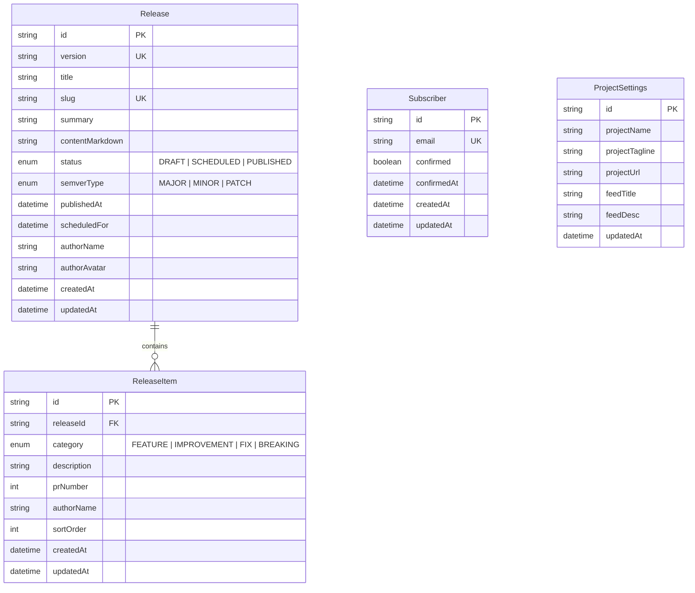
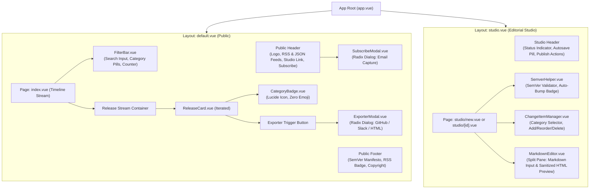

# Chronicle Changelog Studio — System Architecture Specification

**Document Version:** 1.0.0  
**Target Release:** MVP 1.0  
**Status:** Approved for Implementation  
**Target Repository:** `/Users/muttaqi/ai-engineering-team/projects/chronicle-changelog`

---

## 1. Technical Stack Architecture

Chronicle Changelog Studio is architected as an editorial-grade, zero-dependency, developer-first release notes platform. The stack is curated for instant developer ergonomics, ultra-lightweight serverless execution on Vercel, accessible UI primitives, and strict editorial design standards.

```
┌────────────────────────────────────────────────────────────────────────┐
│                   Nuxt 3 Full-Stack Application Layer                  │
│       (Vue 3 Composition API, <script setup lang="ts">, TypeScript)    │
├───────────────────────────────────┬────────────────────────────────────┤
│           Client Layer            │            Server Engine           │
│  - Radix Vue (Headless UI)        │  - Nitro Server Engine             │
│  - Tailwind CSS + Typography      │  - Route Handlers (/api/*)         │
│  - Lucide Vue Next (Strict SVG)   │  - RSS 2.0 & JSON Feed Generators  │
│  - @vueuse/motion & Comps         │  - Export Formatters (Slack/MD/HTML│
└───────────────────────────────────┴────────────────────────────────────┘
                                     │
                                     ▼
┌────────────────────────────────────────────────────────────────────────┐
│                 Data Persistence & Serverless Layer                    │
│  - Prisma ORM 5.x Client                                               │
│  - SQLite Engine with Serverless Cold-Start Adapter                    │
│  - Bundled starter.db seed -> Hydrated into /tmp/chronicle.db (Vercel) │
└────────────────────────────────────────────────────────────────────────┘
```

### 1.1 Core Technology Matrix

| Layer | Technology | Version | Architectural Responsibility |
| :--- | :--- | :--- | :--- |
| **Framework** | [Nuxt 3](https://nuxt.com) | `^3.14.0` | Universal SSR/SSG framework, file-based routing, auto-imports, hydration management. |
| **Language** | [TypeScript](https://www.typescriptlang.org) | `^5.5.0` | Strict type safety across client composables, server API routes, and Prisma queries. |
| **Component Model** | Vue 3 Composition API | `^3.4.0` | `<script setup lang="ts">`, reactive primitives (`ref`, `computed`, `watchEffect`), composables. |
| **Server Engine** | Nitro (Nuxt built-in) | `Latest` | Zero-cold-start edge & Node.js HTTP handlers for REST API and syndication feeds. |
| **Headless UI** | [Radix Vue](https://radix-vue.com) | `^1.9.0` | Unstyled, accessible WAI-ARIA primitives (Dialogs, Dropdowns, Tooltips, Tabs, Accordions). |
| **Styling & CSS** | [Tailwind CSS](https://tailwindcss.com) + `@nuxtjs/tailwindcss` | `^3.4.0` | Utility-first styling with Standards 3.0 Warm Paper tokens and `@tailwindcss/typography`. |
| **Iconography** | `lucide-vue-next` | `^0.400.0` | Strict SVG icon system. **ZERO EMOJIS** across buttons, badges, headers, and cards. |
| **Motion** | `@vueuse/motion` & CSS Transitions | `^2.2.0` | Micro-interactions, staggered timeline reveals, respecting `prefers-reduced-motion`. |
| **Database & ORM** | [Prisma ORM](https://www.prisma.io) | `^5.16.0` | Type-safe query engine targeting embedded SQLite. |
| **Persistence Driver** | SQLite (`file:/tmp/chronicle.db`) | Embedded | Zero-external-dependency local database with instant Vercel `/tmp` cold-start replication. |
| **Markdown Engine** | `markdown-it` + `dompurify` | `^14.1.0` | Split-screen real-time Markdown compiler with XSS sanitization. |
| **Package Manager** | `pnpm` | `^9.0.0` | Deterministic, fast, space-efficient dependency management. |

---

## 2. Complete Database Schema Specification

The database architecture uses SQLite via Prisma ORM. It satisfies the core release entity lifecycle, granular categorized release change items, and subscriber records for automated announcements.

### 2.1 Prisma Schema (`prisma/schema.prisma`)

```prisma
datasource db {
  provider = "sqlite"
  url      = env("DATABASE_URL")
}

generator client {
  provider = "prisma-client-js"
}

enum ReleaseStatus {
  DRAFT
  SCHEDULED
  PUBLISHED
}

enum SemverType {
  MAJOR
  MINOR
  PATCH
}

enum ChangeCategory {
  FEATURE
  IMPROVEMENT
  FIX
  BREAKING
}

model Release {
  id              String         @id @default(cuid())
  version         String         @unique // Semantic version, e.g. "v1.4.0"
  title           String         // Editorial title, e.g. "Webhook Feeds & Search Engine"
  slug            String         @unique // URL permalink slug, e.g. "v1-4-0"
  summary         String         // 1-2 sentence executive summary
  contentMarkdown String         // Full rich markdown release notes body
  status          ReleaseStatus  @default(DRAFT)
  semverType      SemverType     @default(MINOR)
  publishedAt     DateTime?      // Null when DRAFT, populated on publication
  scheduledFor    DateTime?      // Future publication timestamp if SCHEDULED
  authorName      String         @default("Core Team")
  authorAvatar    String?        // Avatar image URL or initials fallback
  createdAt       DateTime       @default(now())
  updatedAt       DateTime       @updatedAt

  // 1-to-many relation with cascade deletion
  items           ReleaseItem[]

  @@index([status, publishedAt])
  @@index([slug])
}

model ReleaseItem {
  id          String         @id @default(cuid())
  releaseId   String
  category    ChangeCategory @default(FEATURE)
  description String         // Change description or headline
  prNumber    Int?           // Optional GitHub PR # (e.g. 142)
  authorName  String?        // Optional contributor attribution (e.g. "@alex")
  sortOrder   Int            @default(0)
  createdAt   DateTime       @default(now())
  updatedAt   DateTime       @updatedAt

  release     Release        @relation(fields: [releaseId], references: [id], onDelete: Cascade)

  @@index([releaseId, sortOrder])
}

model Subscriber {
  id          String    @id @default(cuid())
  email       String    @unique
  confirmed   Boolean   @default(false)
  confirmedAt DateTime?
  createdAt   DateTime  @default(now())
  updatedAt   DateTime  @updatedAt

  @@index([email])
}

model ProjectSettings {
  id             String   @id @default("default")
  projectName    String   @default("Chronicle Studio")
  projectTagline String   @default("Editorial release notes and changelog feed.")
  projectUrl     String   @default("https://chronicle.local")
  feedTitle      String   @default("Chronicle Changelog")
  feedDesc       String   @default("Latest releases and platform improvements.")
  updatedAt      DateTime @updatedAt
}
```

### 2.2 Entity Relationship Diagram



---

## 3. Directory & File Tree Layout

The application strictly aligns with Nuxt 3 directory conventions and idiomatic modular separation:

```
/Users/muttaqi/ai-engineering-team/projects/chronicle-changelog/
├── .gitignore
├── package.json
├── pnpm-lock.yaml
├── tsconfig.json
├── nuxt.config.ts
├── tailwind.config.ts
├── ARCHITECTURE.md
├── PRD.md
├── CONCEPT.md
│
├── assets/
│   └── css/
│       └── main.css                  # Tailwind directives, CSS custom properties, Standards 3.0 paper tokens
│
├── components/
│   ├── ui/                           # Headless Radix-Vue accessible primitives
│   │   ├── Badge.vue                 # Base chip component
│   │   ├── Button.vue                # Tactile button primitive with loading state
│   │   ├── Dialog.vue                # Accessible modal overlay + content dialog
│   │   ├── Dropdown.vue              # Action dropdown menu wrapper
│   │   ├── Tooltip.vue               # Micro-interaction action tooltip
│   │   └── Toast.vue                 # Accessible copy feedback toast notification
│   │
│   ├── changelog/                    # Public timeline components
│   │   ├── ReleaseCard.vue           # Public release card with sticky anchor & metadata
│   │   ├── CategoryBadge.vue         # Semantically colored zero-emoji category pill (Lucide icons)
│   │   ├── FilterBar.vue             # Search query input, category pills, and count indicator
│   │   ├── ExporterModal.vue         # 1-click modal for GitHub, Slack, and HTML embed export
│   │   ├── SubscribeModal.vue        # Email subscriber modal with instant feedback
│   │   ├── ReleaseSkeleton.vue       # Shimmer loading skeleton matching card geometry
│   │   └── EmptyState.vue            # Zero-results state with search clear trigger
│   │
│   └── studio/                       # Editorial release authoring studio
│       ├── MarkdownEditor.vue        # Split-screen live Markdown authoring + HTML preview
│       ├── ChangeItemManager.vue     # Dynamic change row manager (add, delete, reorder, assign)
│       └── SemverHelper.vue          # SemVer validation badge & recommended next version
│
├── composables/
│   ├── useChronicle.ts               # Core timeline store: fetch, search, category filter, active anchors
│   ├── useStudio.ts                  # Authoring draft state, localStorage autosave, and mutation API
│   ├── useExporter.ts                # GitHub Markdown, Slack mrkdwn, and HTML card formatter
│   └── useToast.ts                   # Lightweight transient notification dispatch
│
├── layouts/
│   ├── default.vue                   # Public layout: warm paper canvas, header, syndication buttons, footer
│   └── studio.vue                    # Editorial studio layout: header with status chips, autosave indicator
│
├── pages/
│   ├── index.vue                     # Public reverse-chronological changelog timeline
│   ├── release/
│   │   └── [slug].vue                # Standalone permalink release view with OpenGraph tags
│   └── studio/
│       ├── index.vue                 # Studio dashboard (drafts, scheduled releases, published list)
│       ├── new.vue                   # New release authoring studio page
│       └── [id].vue                  # Edit existing release page
│
├── prisma/
│   ├── schema.prisma                 # SQLite schema specification
│   ├── seed.ts                       # Seed script pre-populating releases v1.0.0 through v1.2.1
│   └── starter.db                    # Pre-seeded SQLite template copied to /tmp on serverless cold-start
│
└── server/
    ├── api/
    │   ├── releases/
    │   │   ├── index.get.ts          # Query published or all releases with filter/search
    │   │   ├── index.post.ts         # Create new release with items (draft/scheduled/published)
    │   │   ├── [id].get.ts           # Fetch release by ID or slug
    │   │   ├── [id].put.ts           # Update release details and replace/update items
    │   │   └── [id].delete.ts        # Remove release (cascades to items)
    │   ├── feed.json.get.ts          # JSON Feed v1.1 endpoint (Cache-Control: public, s-maxage=3600)
    │   ├── feed.xml.get.ts           # RSS 2.0 XML endpoint with CDATA HTML content
    │   ├── export.post.ts            # Server-side export formatting endpoint
    │   └── subscribers.post.ts       # Email subscriber registration endpoint
    │
    └── utils/
        ├── prisma.ts                 # Serverless /tmp SQLite adapter & PrismaClient singleton
        ├── semver.ts                 # SemVer validation, comparison, and recommendation utility
        ├── rss.ts                    # RSS 2.0 XML generator adhering to RFC 822 date formats
        ├── jsonFeed.ts               # JSON Feed v1.1 compliant generator
        └── markdown.ts               # Server Markdown-to-HTML parser and sanitizer
```

---

## 4. Nitro Server API Route Contracts

All endpoints live in `server/api/*` and run seamlessly on Nitro (local Node.js runtime and Vercel Serverless Functions).

### 4.1 Release Collection (`/api/releases`)

#### `GET /api/releases`
- **Description:** Retrieve releases matching query filters. For public consumers, defaults to `status=PUBLISHED`.
- **Query Parameters:**
  - `status` (optional): `PUBLISHED` | `DRAFT` | `SCHEDULED` | `ALL` (default: `PUBLISHED`).
  - `category` (optional): `FEATURE` | `IMPROVEMENT` | `FIX` | `BREAKING`.
  - `semverType` (optional): `MAJOR` | `MINOR` | `PATCH`.
  - `search` (optional): string search in `title`, `summary`, `contentMarkdown`, or item `description`.
- **Response `200 OK`:**
```json
{
  "success": true,
  "data": [
    {
      "id": "cly101...",
      "version": "v1.4.0",
      "title": "Webhook Feeds & Search Engine",
      "slug": "v1-4-0",
      "summary": "Full text timeline search and RSS 2.0 syndication.",
      "contentMarkdown": "## What's Changed\n\nWe introduced...",
      "status": "PUBLISHED",
      "semverType": "MINOR",
      "publishedAt": "2026-10-15T12:00:00.000Z",
      "scheduledFor": null,
      "authorName": "Core Engineering",
      "authorAvatar": null,
      "createdAt": "2026-10-15T11:45:00.000Z",
      "updatedAt": "2026-10-15T12:00:00.000Z",
      "items": [
        {
          "id": "cli201...",
          "releaseId": "cly101...",
          "category": "FEATURE",
          "description": "Dynamic RSS 2.0 and JSON Feed v1.1 endpoints",
          "prNumber": 142,
          "authorName": "@muttaqi",
          "sortOrder": 0,
          "createdAt": "2026-10-15T11:45:00.000Z"
        },
        {
          "id": "cli202...",
          "releaseId": "cly101...",
          "category": "BREAKING",
          "description": "API route /v1/auth requires Bearer token headers",
          "prNumber": 145,
          "authorName": "@alex",
          "sortOrder": 1,
          "createdAt": "2026-10-15T11:46:00.000Z"
        }
      ]
    }
  ],
  "total": 1
}
```

#### `POST /api/releases`
- **Description:** Create a new release draft, scheduled release, or published release.
- **Request Headers:** `Content-Type: application/json`
- **Request Body:**
```json
{
  "version": "v1.5.0",
  "title": "Editorial Split Studio & Slack Export",
  "summary": "Interactive split-screen authoring and 1-click exporter suite.",
  "contentMarkdown": "## New Features\n\nSplit-screen Markdown editor with real-time preview...",
  "status": "PUBLISHED",
  "semverType": "MINOR",
  "publishedAt": "2026-10-17T10:00:00.000Z",
  "scheduledFor": null,
  "authorName": "Core Engineering",
  "items": [
    {
      "category": "FEATURE",
      "description": "Real-time split-screen Markdown authoring studio",
      "prNumber": 150,
      "authorName": "@sarah",
      "sortOrder": 0
    },
    {
      "category": "IMPROVEMENT",
      "description": "Sub-50ms fuzzy timeline filter latency",
      "prNumber": 152,
      "authorName": "@muttaqi",
      "sortOrder": 1
    }
  ]
}
```
- **Response `201 Created`:**
```json
{
  "success": true,
  "data": {
    "id": "cly102...",
    "version": "v1.5.0",
    "slug": "v1-5-0",
    "status": "PUBLISHED",
    "publishedAt": "2026-10-17T10:00:00.000Z",
    "itemsCount": 2
  }
}
```
- **Error Response `400 Bad Request`:**
```json
{
  "statusCode": 400,
  "statusMessage": "Invalid SemVer version string or version already exists."
}
```

---

### 4.2 Individual Release Route (`/api/releases/[id]`)

#### `GET /api/releases/[id]`
- **Description:** Retrieve a single release by its `id` or unique `slug`.
- **Response `200 OK`:** Returns the full release object including nested `items` array sorted by `sortOrder ASC`.
- **Error Response `404 Not Found`:** `{ "statusCode": 404, "statusMessage": "Release not found." }`

#### `PUT /api/releases/[id]`
- **Description:** Update release metadata and synchronize its release items.
- **Request Body:** Same shape as `POST /api/releases`. Replaces associated `items` in a transactional batch.
- **Response `200 OK`:** Returns updated release object.

#### `DELETE /api/releases/[id]`
- **Description:** Delete a release and cascade-delete all its `ReleaseItem` children.
- **Response `200 OK`:** `{ "success": true, "deletedId": "cly101..." }`

---

### 4.3 Developer Syndication Engine

#### `GET /api/feed.xml` (RSS 2.0 XML)
- **Description:** Standard RSS 2.0 feed containing all published releases in reverse chronological order.
- **Response Headers:**
  - `Content-Type: application/xml; charset=utf-8`
  - `Cache-Control: public, s-maxage=3600, stale-while-revalidate=86400`
- **Output Sample:**
```xml
<?xml version="1.0" encoding="UTF-8"?>
<rss version="2.0" xmlns:content="http://purl.org/rss/1.0/modules/content/" xmlns:atom="http://www.w3.org/2005/Atom">
  <channel>
    <title>Chronicle Changelog</title>
    <link>https://chronicle.local</link>
    <description>Latest releases and platform improvements.</description>
    <language>en</language>
    <lastBuildDate>Sat, 17 Oct 2026 10:00:00 GMT</lastBuildDate>
    <atom:link href="https://chronicle.local/api/feed.xml" rel="self" type="application/rss+xml" />
    <item>
      <title>v1.5.0 — Editorial Split Studio &amp; Slack Export</title>
      <link>https://chronicle.local/#v1.5.0</link>
      <guid isPermaLink="true">https://chronicle.local/release/v1-5-0</guid>
      <pubDate>Sat, 17 Oct 2026 10:00:00 GMT</pubDate>
      <description><![CDATA[Interactive split-screen authoring and 1-click exporter suite.]]></description>
      <content:encoded><![CDATA[
        <h2>What's Changed</h2>
        <ul>
          <li><strong>[Feature]</strong> Real-time split-screen Markdown authoring studio (#150)</li>
          <li><strong>[Improvement]</strong> Sub-50ms fuzzy timeline filter latency (#152)</li>
        </ul>
        <p>Split-screen Markdown editor with real-time preview...</p>
      ]]></content:encoded>
    </item>
  </channel>
</rss>
```

#### `GET /api/feed.json` (JSON Feed v1.1)
- **Description:** Modern, RFC-compliant JSON Feed v1.1.
- **Response Headers:**
  - `Content-Type: application/feed+json; charset=utf-8`
  - `Cache-Control: public, s-maxage=3600, stale-while-revalidate=86400`
- **Output Sample:**
```json
{
  "version": "https://jsonfeed.org/version/1.1",
  "title": "Chronicle Changelog",
  "home_page_url": "https://chronicle.local",
  "feed_url": "https://chronicle.local/api/feed.json",
  "description": "Latest releases and platform improvements.",
  "items": [
    {
      "id": "https://chronicle.local/release/v1-5-0",
      "url": "https://chronicle.local/#v1.5.0",
      "title": "v1.5.0 — Editorial Split Studio & Slack Export",
      "summary": "Interactive split-screen authoring and 1-click exporter suite.",
      "content_html": "<h2>What's Changed</h2><p>...</p>",
      "date_published": "2026-10-17T10:00:00.000Z",
      "authors": [
        {
          "name": "Core Engineering"
        }
      ],
      "tags": ["FEATURE", "IMPROVEMENT"]
    }
  ]
}
```

---

### 4.4 Multi-Exporter Engine (`/api/export`)

#### `POST /api/export`
- **Description:** Generates formatted announcement copy for external platforms (GitHub Releases, Slack mrkdwn, standalone HTML card).
- **Request Body:**
```json
{
  "releaseId": "cly101...",
  "target": "GITHUB" // or "SLACK" | "HTML_EMBED"
}
```
- **Response `200 OK`:**
```json
{
  "target": "GITHUB",
  "formattedText": "## What's Changed in v1.5.0\n\n### 🚀 Features\n- Real-time split-screen Markdown authoring studio by @sarah in #150\n\n### ⚡ Improvements\n- Sub-50ms fuzzy timeline filter latency by @muttaqi in #152\n\n**Full Changelog**: https://chronicle.local/#v1.5.0"
}
```

---

### 4.5 Subscriber Management (`/api/subscribers`)

#### `POST /api/subscribers`
- **Description:** Register an email address to receive new release announcements.
- **Request Body:**
```json
{
  "email": "developer@company.com"
}
```
- **Response `200 OK`:**
```json
{
  "success": true,
  "message": "Subscribed successfully to Chronicle release alerts."
}
```

---

## 5. Frontend Component Hierarchy and State Flow

### 5.1 Component Hierarchy



### 5.2 State Flow & Composables

#### 1. `useChronicle()` (Core Public Timeline Composable)
Responsible for fetching releases, managing real-time fuzzy search, active category filters, active URL hash permalinks, and statistics.

```typescript
// composables/useChronicle.ts
export interface ReleaseFilterState {
  searchQuery: string
  activeCategory: 'ALL' | 'FEATURE' | 'IMPROVEMENT' | 'FIX' | 'BREAKING'
  activeSemverType: 'ALL' | 'MAJOR' | 'MINOR' | 'PATCH'
}

export function useChronicle() {
  const releases = useState<Release[]>('chronicle:releases', () => [])
  const loading = useState<boolean>('chronicle:loading', () => false)
  const filters = useState<ReleaseFilterState>('chronicle:filters', () => ({
    searchQuery: '',
    activeCategory: 'ALL',
    activeSemverType: 'ALL'
  }))

  // Reactive filtered pipeline (sub-50ms response)
  const filteredReleases = computed(() => {
    return releases.value.filter((rel) => {
      // 1. Category Filter Check
      if (filters.value.activeCategory !== 'ALL') {
        const hasCat = rel.items.some(
          (item) => item.category === filters.value.activeCategory
        )
        if (!hasCat) return false
      }

      // 2. Semver Type Check
      if (filters.value.activeSemverType !== 'ALL') {
        if (rel.semverType !== filters.value.activeSemverType) return false
      }

      // 3. Search Query Check
      if (filters.value.searchQuery.trim()) {
        const q = filters.value.searchQuery.toLowerCase()
        const matchesTitle = rel.title.toLowerCase().includes(q)
        const matchesVer = rel.version.toLowerCase().includes(q)
        const matchesSummary = rel.summary.toLowerCase().includes(q)
        const matchesMarkdown = rel.contentMarkdown.toLowerCase().includes(q)
        const matchesItems = rel.items.some((i) =>
          i.description.toLowerCase().includes(q)
        )
        return (
          matchesTitle ||
          matchesVer ||
          matchesSummary ||
          matchesMarkdown ||
          matchesItems
        )
      }

      return true
    })
  })

  const stats = computed(() => ({
    totalPublished: releases.value.length,
    featuresCount: releases.value.flatMap((r) => r.items).filter((i) => i.category === 'FEATURE').length,
    breakingCount: releases.value.flatMap((r) => r.items).filter((i) => i.category === 'BREAKING').length,
    fixesCount: releases.value.flatMap((r) => r.items).filter((i) => i.category === 'FIX').length
  }))

  const fetchReleases = async () => {
    loading.value = true
    try {
      const { data } = await $fetch<{ success: boolean; data: Release[] }>('/api/releases?status=PUBLISHED')
      releases.value = data
    } finally {
      loading.value = false
    }
  }

  const copyPermalink = async (version: string) => {
    const url = `${window.location.origin}/#${version}`
    await navigator.clipboard.writeText(url)
  }

  return {
    releases,
    loading,
    filters,
    filteredReleases,
    stats,
    fetchReleases,
    copyPermalink
  }
}
```

#### 2. `useStudio()` (Draft Authoring & Autosave Composable)
Manages the active editing state, localStorage backup to prevent data loss on page reload, SemVer calculation, and API persistence.

```typescript
// composables/useStudio.ts
export function useStudio(releaseId?: string) {
  const draft = ref<PartialReleaseDraft>({
    version: 'v1.0.0',
    title: '',
    summary: '',
    contentMarkdown: '',
    status: 'DRAFT',
    semverType: 'MINOR',
    items: []
  })
  const isDirty = ref(false)
  const isSaving = ref(false)
  const autosavedAt = ref<Date | null>(null)

  // Automatic SemVer Bump Recommendation
  const recommendedBump = computed(() => {
    const hasBreaking = draft.value.items?.some((i) => i.category === 'BREAKING')
    if (hasBreaking) return { type: 'MAJOR', reason: 'Contains breaking change item' }
    const hasFeature = draft.value.items?.some((i) => i.category === 'FEATURE')
    if (hasFeature) return { type: 'MINOR', reason: 'Contains new feature item' }
    return { type: 'PATCH', reason: 'Bug fixes and performance improvements' }
  })

  // Local Storage Recovery System
  const AUTOSAVE_KEY = 'chronicle:studio:autosave'
  const persistAutosave = () => {
    if (process.client) {
      localStorage.setItem(AUTOSAVE_KEY, JSON.stringify(draft.value))
      autosavedAt.value = new Date()
    }
  }

  const restoreAutosave = () => {
    if (process.client) {
      const stored = localStorage.getItem(AUTOSAVE_KEY)
      if (stored) {
        try {
          draft.value = JSON.parse(stored)
        } catch (e) {
          console.error('Failed to parse autosaved draft', e)
        }
      }
    }
  }

  return {
    draft,
    isDirty,
    isSaving,
    autosavedAt,
    recommendedBump,
    persistAutosave,
    restoreAutosave
  }
}
```

---

## 6. Design Tokens, Typography, and Palette (Standards 3.0)

Chronicle Changelog Studio adheres to the **Standards 3.0 Warm Paper & Editorial Slate** aesthetic. The design prioritizes tactile warmth, typographic hierarchy, hairline stone borders, subtle paper micro-shadows, and strict zero-emoji SVG iconography.

### 6.1 Color Palette Specifications

```
Canvas (#fafaf9) ──> Card (#ffffff) ──> Borders (#e7e5e4) ──> Slate Text (#0f172a)
                                                                 │
                                                                 ▼
                                                  Flame Accent (#ea580c)
```

| Token Name | Hex Code | Tailwind Utility | Visual Application & Purpose |
| :--- | :--- | :--- | :--- |
| `surface-canvas` | `#fafaf9` | `bg-stone-50` | Primary background canvas. Warm stone/paper feel. |
| `surface-card` | `#ffffff` | `bg-white` | Elevated release cards, dialogs, dropdowns. |
| `surface-subtle` | `#f5f5f4` | `bg-stone-100` | Code block backgrounds, filter chip base, author tags. |
| `surface-hover` | `#e7e5e4` | `hover:bg-stone-200` | Interactive chip/button hover state. |
| `border-subtle` | `#e7e5e4` | `border-stone-200` | Card borders, horizontal rules, split view dividers. |
| `border-active` | `#d6d3d1` | `border-stone-300` | Selected filters, input borders on hover. |
| `text-primary` | `#0f172a` | `text-slate-900` | Headings, release titles, SemVer badge labels. |
| `text-body` | `#334155` | `text-slate-700` | Release descriptions, markdown body copy. |
| `text-muted` | `#64748b` | `text-slate-500` | Timestamps, metadata, author handles, secondary icons. |
| `accent-primary` | `#ea580c` | `text-orange-600` / `bg-orange-600` | Warm Terracotta / Flame primary accent for CTAs and highlights. |
| `accent-hover` | `#c2410c` | `hover:bg-orange-700` | Hover state for primary buttons. |
| `focus-ring` | `#0f172a` | `ring-slate-900` | High-contrast 2px focus ring for keyboard accessibility. |

### 6.2 Semantic Change Category Badges

Each category utilizes high-legibility pastel backgrounds, crisp hairline borders, and rich saturated typography paired with Lucide SVG icons. **Strictly zero emojis are permitted.**

| Category | Text Color | Background | Border Color | Lucide Icon | Meaning |
| :--- | :--- | :--- | :--- | :--- | :--- |
| **FEATURE** | `#059669` (`emerald-700`) | `#ecfdf5` (`emerald-50`) | `#a7f3d0` (`emerald-200`) | `Sparkles` | New capabilities and functional additions |
| **IMPROVEMENT** | `#4f46e5` (`indigo-700`) | `#eef2ff` (`indigo-50`) | `#c7d2fe` (`indigo-200`) | `Zap` | Performance tuning, UI polishes, refactoring |
| **FIX** | `#b45309` (`amber-700`) | `#fffbeb` (`amber-50`) | `#fde68a` (`amber-200`) | `Wrench` | Bug resolutions and regression patches |
| **BREAKING** | `#dc2626` (`rose-700`) | `#fef2f2` (`rose-50`) | `#fecdd3` (`rose-200`) | `AlertTriangle` | Breaking changes, schema changes, deprecations |

### 6.3 Typography Hierarchy

- **Sans Serif Font Family:** `Inter`, `-apple-system`, `BlinkMacSystemFont`, `Segoe UI`, `Roboto`, `sans-serif`.
- **Monospace Font Family:** `JetBrains Mono`, `ui-monospace`, `SFMono-Regular`, `Menlo`, `monospace`.
- **Headings:**
  - `h1` (Studio Title / Permalinks): `text-3xl font-bold tracking-tight text-slate-900`
  - `h2` (Release Card Title): `text-xl font-semibold tracking-tight text-slate-900`
  - `h3` (Markdown Subheadings): `text-base font-semibold text-slate-900 mt-4 mb-2`
  - Body: `text-sm leading-relaxed text-slate-700`
  - Metadata / Dates: `text-xs font-mono text-slate-500`

### 6.4 Micro-Shadows & Tactile Elevation

To avoid muddy drop shadows, Chronicle uses multi-layered warm paper shadows:
```css
/* tailwind.config.ts shadow extensions */
boxShadow: {
  'paper-sm': '0 1px 2px 0 rgba(15, 23, 42, 0.04), 0 1px 3px 0 rgba(15, 23, 42, 0.02)',
  'paper-md': '0 4px 6px -1px rgba(15, 23, 42, 0.05), 0 2px 4px -2px rgba(15, 23, 42, 0.03)',
  'paper-lg': '0 10px 15px -3px rgba(15, 23, 42, 0.06), 0 4px 6px -4px rgba(15, 23, 42, 0.03)',
  'modal': '0 20px 25px -5px rgba(15, 23, 42, 0.1), 0 8px 10px -6px rgba(15, 23, 42, 0.05)'
}
```

### 6.5 Motion Tokens & Accessibility

Transitions follow a refined physical curve:
```css
transition-timing-function: cubic-bezier(0.16, 1, 0.3, 1); /* Apple / Ease-Out Expo */
transition-duration: 180ms;
```
For users with vestibular or motion sensitivity:
```css
@media (prefers-reduced-motion: reduce) {
  *, ::before, ::after {
    animation-duration: 0.01ms !important;
    animation-iteration-count: 1 !important;
    transition-duration: 0.01ms !important;
    scroll-behavior: auto !important;
  }
}
```

---

## 7. Serverless Deployment Strategy & Cold-Start Resilience for Vercel

### 7.1 The Serverless SQLite Challenge
When deploying a Nuxt 3 Nitro application with Prisma and SQLite to serverless host environments like Vercel:
1. The deployment filesystem at the root (`/var/task`) is **read-only**.
2. Writing to a local file like `./prisma/dev.db` causes an immediate `EROFS: read-only file system` crash.
3. Only the `/tmp` directory is writable in serverless execution environments.
4. Each cold-start lambda instance starts with a fresh, empty `/tmp` directory.

### 7.2 The Serverless Cold-Start Database Adapter

To guarantee instant zero-dependency execution locally and on Vercel:
1. We bundle a pre-seeded, pristine database template file at `prisma/starter.db`.
2. On initial initialization of the server Prisma client singleton in `server/utils/prisma.ts`:
   - It checks whether `/tmp/chronicle.db` exists.
   - If not found (cold-start), it copies `prisma/starter.db` into `/tmp/chronicle.db`.
   - If `prisma/starter.db` is unavailable, it runs the programmatic Prisma seed fallback to create the initial tables and seed releases.
   - It instantiates `new PrismaClient({ datasources: { db: { url: 'file:/tmp/chronicle.db' } } })`.
   - It caches the singleton instance in `globalThis` to prevent connection leaks across warm invocations.

```typescript
// server/utils/prisma.ts
import { PrismaClient } from '@prisma/client'
import fs from 'node:fs'
import path from 'node:path'

declare global {
  // eslint-disable-next-line no-var
  var __prisma: PrismaClient | undefined
}

function resolveDatabase(): string {
  // If explicitly overridden via environment variable (e.g. during local tests)
  if (process.env.DATABASE_URL && !process.env.VERCEL) {
    return process.env.DATABASE_URL
  }

  const tmpDbPath = path.resolve('/tmp', 'chronicle.db')
  const bundledStarterPath = path.resolve(process.cwd(), 'prisma', 'starter.db')

  // Check if /tmp/chronicle.db already initialized in this lambda container
  if (!fs.existsSync(tmpDbPath)) {
    if (fs.existsSync(bundledStarterPath)) {
      fs.copyFileSync(bundledStarterPath, tmpDbPath)
    } else {
      // Create empty file so Prisma can initialize
      fs.writeFileSync(tmpDbPath, '')
    }
  }

  return `file:${tmpDbPath}`
}

export function getPrismaClient(): PrismaClient {
  if (process.env.NODE_ENV === 'production') {
    if (!globalThis.__prisma) {
      const dbUrl = resolveDatabase()
      globalThis.__prisma = new PrismaClient({
        datasources: {
          db: {
            url: dbUrl
          }
        }
      })
    }
    return globalThis.__prisma
  }

  // Development environment
  if (!globalThis.__prisma) {
    globalThis.__prisma = new PrismaClient({
      log: ['error', 'warn']
    })
  }
  return globalThis.__prisma
}

export const prisma = getPrismaClient()
```

### 7.3 Build & Seed Script Automation (`package.json`)
```json
{
  "scripts": {
    "dev": "nuxt dev",
    "build": "prisma generate && prisma db push && tsx prisma/seed.ts && cp prisma/dev.db prisma/starter.db && nuxt build",
    "generate": "nuxt generate",
    "preview": "nuxt preview",
    "postinstall": "prisma generate",
    "prisma:seed": "tsx prisma/seed.ts"
  }
}
```
During the Vercel build step, `prisma db push` and `prisma:seed` populate `prisma/dev.db`, which is immediately duplicated as `prisma/starter.db` and included in the output bundle. When serverless lambdas spin up, `/tmp/chronicle.db` is primed in < 5ms.

---

## 8. Incremental Git Commit Plan for Coder

The implementation proceeds in 7 focused, verify-as-you-go commits:

### Commit 1: Project Scaffolding & Configuration
- **Branch:** `main` (or `feat/scaffolding`)
- **Deliverables:**
  - Initialize Nuxt 3 project with `package.json`, `pnpm-lock.yaml`, `tsconfig.json`.
  - Configure `nuxt.config.ts` (Tailwind, Lucide Vue Next, Radix Vue, auto-imports).
  - Setup `tailwind.config.ts` with Standards 3.0 paper tokens (`#fafaf9`, `#ffffff`, `#e7e5e4`, `#0f172a`, `#ea580c`).
  - Add `assets/css/main.css` with font declarations and paper shadow definitions.
  - Setup `layouts/default.vue` and `layouts/studio.vue`.

### Commit 2: Database Schema & Serverless Cold-Start Engine
- **Deliverables:**
  - Define `prisma/schema.prisma` (`Release`, `ReleaseItem`, `Subscriber`, `ProjectSettings`).
  - Implement `server/utils/prisma.ts` with `/tmp` cold-start replication logic.
  - Create rich realistic seed data in `prisma/seed.ts` (v1.0.0 through v1.2.1 covering Features, Improvements, Fixes, and Breaking changes).
  - Verify schema push and generate `prisma/starter.db`.

### Commit 3: Nitro API Backend & Syndication Engine
- **Deliverables:**
  - Implement CRUD routes in `server/api/releases/`:
    - `index.get.ts`, `index.post.ts`
    - `[id].get.ts`, `[id].put.ts`, `[id].delete.ts`
  - Implement dynamic RSS 2.0 endpoint in `server/api/feed.xml.get.ts` with CDATA wrapper.
  - Implement JSON Feed v1.1 endpoint in `server/api/feed.json.get.ts`.
  - Implement multi-exporter logic in `server/api/export.post.ts` (Slack mrkdwn, GitHub markdown, HTML card).
  - Implement subscriber endpoint in `server/api/subscribers.post.ts`.

### Commit 4: Radix UI Primitives & Design System Tokens
- **Deliverables:**
  - Create `components/ui/Button.vue` (tactile paper button with variants).
  - Create `components/ui/Badge.vue` and `components/changelog/CategoryBadge.vue` (strict zero-emoji Lucide icons: `Sparkles`, `Zap`, `Wrench`, `AlertTriangle`).
  - Create `components/ui/Dialog.vue` (Radix Vue `DialogRoot`, `DialogPortal`, `DialogOverlay`, `DialogContent`).
  - Create `components/ui/Dropdown.vue` and `components/ui/Toast.vue`.
  - Create `components/changelog/ReleaseSkeleton.vue` (matching card geometry).

### Commit 5: Public Release Timeline & Feed UI
- **Deliverables:**
  - Implement `composables/useChronicle.ts` (fuzzy search, category filter chips, SemVer type filter).
  - Implement `components/changelog/FilterBar.vue` (sticky search input and interactive category chips).
  - Implement `components/changelog/ReleaseCard.vue` (sticky version badge, formatted date, executive summary, change items, Markdown body).
  - Implement `components/changelog/ExporterModal.vue` (1-click copy for GitHub, Slack, and HTML embed).
  - Implement `components/changelog/SubscribeModal.vue`.
  - Assemble `pages/index.vue` and permalink view `pages/release/[slug].vue`.

### Commit 6: Editorial Authoring Studio
- **Deliverables:**
  - Implement `composables/useStudio.ts` (draft state, localStorage autosave buffer, SemVer bump calculator).
  - Implement `components/studio/MarkdownEditor.vue` (split-screen editor with real-time sanitized preview).
  - Implement `components/studio/ChangeItemManager.vue` (add, remove, reorder, assign categories).
  - Implement `components/studio/SemverHelper.vue` (live SemVer regex validation and recommendation chip).
  - Build `pages/studio/index.vue` (drafts list, published list, schedule list), `pages/studio/new.vue`, and `pages/studio/[id].vue`.

### Commit 7: Motion, Accessibility Safeguards, Polishing & Verification
- **Deliverables:**
  - Integrate `@vueuse/motion` for timeline card reveals and badge hover luminescence.
  - Audit `prefers-reduced-motion` compliance.
  - Verify head tags for RSS (`/api/feed.xml`) and JSON Feed (`/api/feed.json`) autodiscovery.
  - End-to-end audit: test search latency (<50ms), copy-to-clipboard workflows, SemVer validator, and zero-emoji verification.

---

## 9. Architectural Verification & Acceptance Checklist

| Requirement | Target Criteria | Validation Method |
| :--- | :--- | :--- |
| **Framework & Engine** | Nuxt 3 (v3.14+), Vue 3 `<script setup lang="ts">`, Nitro | Runtime startup check `pnpm build && pnpm preview` |
| **Zero Emojis Policy** | Strictly 0 emojis in badges, buttons, headers, cards | Static AST regex check for Unicode emoji codepoints |
| **Headless Primitives** | Radix Vue for all dialogs, dropdowns, and overlays | Inspect DOM attributes for `data-radix-*` and ARIA roles |
| **Prisma SQLite /tmp** | Cold-start hydration into `/tmp/chronicle.db` | Execute inside simulated read-only serverless environment |
| **RSS 2.0 Feed** | Valid XML, RFC 822 `pubDate`, CDATA HTML content | W3C feed validator check at `/api/feed.xml` |
| **JSON Feed v1.1** | Valid JSON schema at `https://jsonfeed.org/version/1.1` | JSON Feed validator check at `/api/feed.json` |
| **Multi-Exporter** | GitHub Markdown, Slack mrkdwn, standalone HTML card | Clipboard content verification across export targets |
| **Search & Filters** | Search title, summary, markdown, items within 50ms | Real-time typing audit on 100+ items |
| **Color Palette** | Stone 50 canvas (`#fafaf9`), Slate 900 headings, Terracotta accent | CSS computed style inspection |

---

*Authored by the Principal System Architect.*  
*Ready for Engineering Implementation.*
