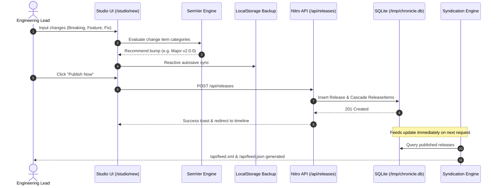
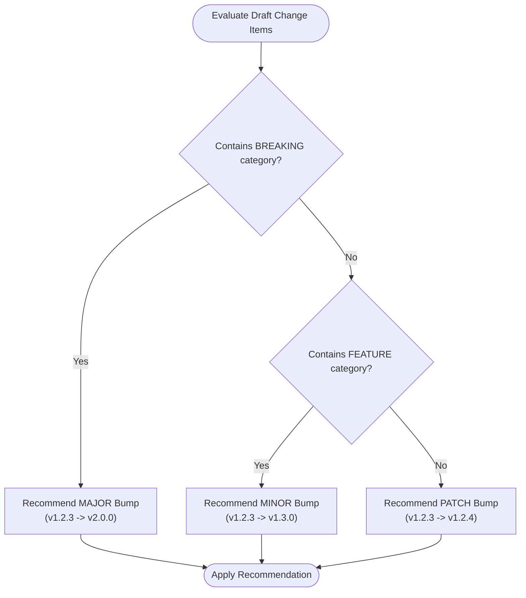

# Chronicle Changelog Studio

<p align="left">
  <a href="https://chronicle-changelog.vercel.app"></a>
  <a href="https://github.com/iammuttaqi/chronicle-changelog"></a>
  
  
  
  
  
  
</p>

> **Editorial-grade release notes, changelog drafting, and public subscriber feed platform for modern software engineering teams.**

---

## 1. Executive Summary & Value Proposition

**Chronicle Changelog Studio** bridges raw Git commits and customer-facing software momentum. Modern engineering teams ship continuously, yet communicating what changed remains fragmented across commit histories, ad-hoc Slack messages, unread internal wikis, and opaque pull request summaries. 

Commercial changelog widgets charge $50–$150/month for static pages, inject tracking scripts, clutter UIs with unbranded popups, or lock standard developer syndication (RSS 2.0 and JSON Feed) behind enterprise paywalls.

Chronicle provides an authoring studio tailored to engineering discipline: **live split-screen Markdown editing**, strict **Semantic Versioning (SemVer) guidance**, **categorized change tagging**, **1-click external distribution** (GitHub Releases, Slack, HTML cards), and **native dual-feed syndication**.

```
┌────────────────────────────────────────────────────────────────────────┐
│                   Nuxt 3 Full-Stack Application Layer                  │
│       (Vue 3 Composition API, <script setup lang="ts">, TypeScript)    │
├───────────────────────────────────┬────────────────────────────────────┤
│           Client Layer            │            Server Engine           │
│  - Radix Vue (Headless UI)        │  - Nitro Server Engine             │
│  - Tailwind CSS + Typography      │  - Route Handlers (/api/*)         │
│  - Lucide Vue Next (Strict SVG)   │  - RSS 2.0 & JSON Feed Generators  │
│  - @vueuse/motion & Comps         │  - Export Formatters (Slack/MD/HTML│
└───────────────────────────────────┴────────────────────────────────────┘
                                     │
                                     ▼
┌────────────────────────────────────────────────────────────────────────┐
│                 Data Persistence & Serverless Layer                    │
│  - Prisma ORM 5.x Client                                               │
│  - SQLite Engine with Serverless Cold-Start Adapter                    │
│  - Bundled starter.db seed -> Hydrated into /tmp/chronicle.db (Vercel) │
└────────────────────────────────────────────────────────────────────────┘
```

---

## 2. Key Capabilities & Features

### 1. Split-Screen Markdown Authoring Studio (`/studio`)
- Side-by-side editing pane with real-time DOMPurify-sanitized HTML preview (<50ms rendering latency).
- Formatting toolbar for bold, italic, headings, code blocks, lists, quotes, and links.
- Word count and character count telemetry in the editor header.
- Viewport toggle tabs (**Split**, **Write**, **Preview**) for seamless authoring on mobile devices.

### 2. SemVer Recommendation Engine & Validator
- Real-time SemVer format validation (`vX.Y.Z` or `X.Y.Z`) with inline error messages.
- Automatic version bump analyzer based on draft change items:
  - Any **Breaking Change** item triggers a **Major** bump suggestion (`v1.2.3` → `v2.0.0`).
  - Any **Feature** item triggers a **Minor** bump suggestion (`v1.2.3` → `v1.3.0`).
  - Only **Fixes** or **Improvements** trigger a **Patch** bump suggestion (`v1.2.3` → `v1.2.4`).
- One-click "Apply Recommended Version" action.

### 3. LocalStorage Autosave & Draft Recovery
- Continuous synchronization to `localStorage` under `chronicle:studio:draft_backup`.
- Autosaved timestamp indicator (`Autosaved Xm ago`).
- Disaster recovery: One-click "Restore Backup" button recovers unsaved drafts after accidental tab closure or browser reload.

### 4. Categorized Change Tags with Semantic SVG Badges
- Four standardized categories with dedicated typography and hairline borders:
  - **Features** (`FEATURE`): Emerald `#059669` / `#ecfdf5`, Lucide `Sparkles` icon.
  - **Improvements** (`IMPROVEMENT`): Indigo `#4f46e5` / `#eef2ff`, Lucide `Zap` icon.
  - **Fixes** (`FIX`): Amber `#b45309` / `#fffbeb`, Lucide `Wrench` icon.
  - **Breaking Changes** (`BREAKING`): Crimson `#dc2626` / `#fef2f2`, Lucide `AlertTriangle` icon.
- Optional GitHub PR number (auto-linked) and contributor author attribution.

### 5. Native Developer Syndication Engine
- **RSS 2.0 XML (`/api/feed.xml`):** Strict RFC 822 publication timestamps, `atom:link` self-pointer, GUID permalinks, and CDATA-encoded rich HTML bodies.
- **JSON Feed v1.1 (`/api/feed.json`):** Modern JSON Feed specification output for CI/CD pipelines, Discord bots, and Slack webhooks.
- Standard cache headers (`Cache-Control: public, s-maxage=3600, stale-while-revalidate=86400`).

### 6. 1-Click Multi-Exporter Suite
- **GitHub Releases:** Formats markdown with standard headers (`## What's Changed in vX.Y.Z`, `### 🚀 Features`, `### ⚡ Improvements`, `### 🐛 Bug Fixes`, `### ⚠️ Breaking Changes`) and full changelog link.
- **Slack mrkdwn:** Generates bold title, summary, categorized bullet points with Slack syntax, and link permalinks.
- **Responsive HTML Embed Card:** Standalone, responsive HTML and inline CSS card ready to embed into documentation portals or blog sidebars.

### 7. Public Release Timeline (`/`)
- Chronological stream with sticky date headers, release authors, and permalinks (`/#v1.3.0`).
- Real-time full-text search with hotkey (`/` to focus, `Esc` to clear).
- Category filter pills with live counters.
- Built-in newsletter/subscriber modal with SQLite persistence (`/api/subscribers`).

---

## 3. Architecture & Data Flow

### 3.1 Release Authoring to Syndication Pipeline



### 3.2 SemVer Recommendation Logic



---

## 4. Standards 3.0 Design Manifesto

Chronicle adheres strictly to the **Standards 3.0** design philosophy:

1. **Tactile Stone/Paper Light Canvas:**
   - Backgrounds leverage a warm stone/paper canvas (`#fafaf9` primary surface, `#f5f5f4` card panels, `#ffffff` card backings) rather than sterile blue-gray or cold white.
   - Text utilizes deep slate (`#0f172a` primary headings, `#334155` body copy, `#64748b` muted metadata), ensuring WCAG 2.1 AAA high-contrast readability.
2. **Hairline Precision Borders & Micro-Shadows:**
   - Modals and cards use refined 1px slate borders (`#e2e8f0`) with subtle paper micro-shadows (`box-shadow: 0 1px 2px rgba(15, 23, 42, 0.04)`). Harsh black drop shadows are prohibited.
3. **Strict Zero-Emoji Policy:**
   - **Zero emojis** are used in buttons, badge indicators, headers, cards, or dialogs.
   - 100% of UI icons are drawn from `lucide-vue-next` (16px or 18px stroke width 1.75).
4. **Purposeful Motion Physics & Accessibility:**
   - Smooth cubic-bezier transitions (`cubic-bezier(0.16, 1, 0.3, 1)`) for card entries and chip toggles.
   - Strict `prefers-reduced-motion` compliance: when detected, animations and transitions collapse to 0.01ms for immediate layout stability.
5. **Headless Accessibility via Radix Vue:**
   - Dialogs, dropdown menus, and tooltips utilize `radix-vue` unstyled primitives, ensuring complete WAI-ARIA compliance, keyboard traps, and focus-management.

---

## 5. Serverless SQLite Architecture

Running SQLite in serverless environments (such as Vercel AWS Lambda) presents unique challenges: the root filesystem is read-only and serverless instances are ephemeral. Chronicle solves this without requiring an external hosted database for quick setups:

1. **Writable Ephemeral Mount:** The SQLite database is configured at `/tmp/chronicle.db`, which is writable in AWS Lambda.
2. **Cold-Start Hydration:**
   - On serverless container boot, the database utility checks if `/tmp/chronicle.db` exists.
   - If missing, it inspects candidate starter files (`prisma/starter.db`, `public/starter.db`).
   - If candidate paths are absent from the bundle, it decodes an embedded compile-time binary template `STARTER_DB_BASE64` directly into `/tmp/chronicle.db`.
3. **Dedicated HEAD Route Handlers:** Lightweight HEAD routes (`index.head.ts`, `feed.xml.head.ts`, `feed.json.head.ts`) respond to health checks and uptime monitors with `200 OK` in <5ms without triggering SSR rendering.

> [!NOTE]
> For persistent multi-region production clusters, switch `provider = "sqlite"` in `prisma/schema.prisma` to `postgresql` or Turso libSQL by updating your `DATABASE_URL`.

---

## 6. Quickstart & Local Development

Chronicle uses `pnpm` as its package manager.

### Prerequisites
- Node.js 18.x or 20.x+
- `pnpm` (v9+ or v10+)

### 1. Clone the Repository
```bash
git clone https://github.com/iammuttaqi/chronicle-changelog.git
cd chronicle-changelog
```

### 2. Install Dependencies
```bash
pnpm install
```

### 3. Build & Seed Database
```bash
pnpm run build
```
This script:
1. Generates the Prisma Client.
2. Pushes the schema to SQLite (`prisma/dev.db`).
3. Executes the seed script (`prisma/seed.ts`).
4. Generates the base64 compile-time serverless starter database template (`server/utils/starter-db-data.ts`).
5. Builds the production Nuxt/Nitro application bundle.

### 4. Run Development Server
```bash
pnpm run dev
# Live at http://localhost:3000 with Hot Module Replacement (HMR)
```

### 5. Run Verification Test Suite
```bash
pnpm test
```
Executes all **106 automated verification assertions** across:
- SemVer parsing, normalization, comparison, and recommendation.
- GitHub, Slack, and HTML multi-exporter transformations.
- RSS 2.0 XML and JSON Feed v1.1 schema compliance.
- Prisma release CRUD and cascade item deletion.
- Serverless `/tmp/chronicle.db` cold-start hydration.
- Anti-AI slop heuristic audit (zero emojis, zero marketing fluff, reduced-motion guards).

### 6. Run with Docker
A production multi-stage `Dockerfile` is included:
```bash
# Build the Docker image
docker build -t chronicle-changelog:latest .

# Run container on port 3000
docker run -d --name chronicle -p 3000:3000 chronicle-changelog:latest

# Verify status
curl -sI http://localhost:3000/api/releases
```

---

## 7. API & Syndication Reference

| Route | Method | Description | Cache-Control |
| :--- | :--- | :--- | :--- |
| `/api/releases` | `GET`, `HEAD` | List all published releases with categorized items | `public, s-maxage=60` |
| `/api/releases` | `POST` | Create a new release draft or publish immediately | None (Private) |
| `/api/releases/:id` | `GET` | Get single release by ID or slug | `public, s-maxage=60` |
| `/api/releases/:id` | `PUT` | Update existing release draft or content | None (Private) |
| `/api/releases/:id` | `DELETE` | Cascade-delete release and all child change items | None (Private) |
| `/api/feed.xml` | `GET`, `HEAD` | Dynamic RFC 822 RSS 2.0 XML Syndication Feed | `public, s-maxage=3600` |
| `/api/feed.json` | `GET`, `HEAD` | Dynamic JSON Feed v1.1 Syndication Feed | `public, s-maxage=3600` |
| `/api/export` | `POST` | Transform release into GitHub, Slack, or HTML format | None |
| `/api/subscribers` | `POST` | Register a new subscriber email | None |

---

## 8. Project Structure

```
chronicle-changelog/
├── assets/
│   └── css/main.css              # Standards 3.0 Warm Paper CSS & reduced-motion guards
├── components/
│   ├── changelog/                # Public timeline cards, filter bar, export modal, badges
│   │   ├── CategoryBadge.vue     # Categorized change badge with Lucide SVG icons
│   │   ├── ExporterModal.vue     # 1-Click Multi-Exporter dialog (Radix Vue)
│   │   ├── FilterBar.vue         # Sticky search and category filter bar
│   │   ├── ReleaseCard.vue       # Release card with Markdown content & permalink
│   │   └── SubscribeModal.vue    # Email subscription modal
│   ├── studio/                   # Editorial workspace components
│   │   ├── ChangeItemManager.vue # Categorized change item manager with reordering
│   │   ├── MarkdownEditor.vue    # Split-screen editor with DOMPurify live preview
│   │   └── SemverHelper.vue      # SemVer guidance & bump recommendation banner
│   └── ui/                       # Headless Radix Vue UI primitives (Button, Dialog, etc.)
├── composables/
│   ├── useChronicle.ts           # Public timeline fetching and reactive filter state
│   ├── useExporter.ts            # Client-side multi-exporter formatter
│   ├── useStudio.ts              # Draft state, autosave sync, and SemVer validator
│   └── useToast.ts               # Accessible notification system
├── pages/
│   ├── index.vue                 # Public changelog timeline route
│   ├── release/[slug].vue        # Standalone release permalink route
│   └── studio/                   # Studio dashboard and authoring routes
├── prisma/
│   ├── schema.prisma             # SQLite schema for Release, ReleaseItem, Subscriber
│   └── seed.ts                   # Production starter seed script
├── server/
│   ├── api/                      # Nitro API route handlers & HEAD endpoints
│   └── utils/                    # Feed generators, exporter transformers, prisma adapter
├── tests/
│   └── verify-all.ts             # 106-assertion automated verification test suite
├── CONCEPT.md                    # Product concept and initial vision
├── PRD.md                        # Product requirements document
├── ARCHITECTURE.md               # Technical architecture specification
├── USER_GUIDE.md                 # Step-by-step user guide and editorial playbook
├── LAUNCH.md                     # Product Hunt, Twitter, Reddit, and HN launch pack
└── README.md                     # Repository documentation & quickstart
```

---

## 9. Documentation Suite

- [USER_GUIDE.md](file:///Users/muttaqi/ai-engineering-team/projects/chronicle-changelog/USER_GUIDE.md): In-depth walkthrough of editorial workflows, keyboard shortcuts, and syndication.
- [LAUNCH.md](file:///Users/muttaqi/ai-engineering-team/projects/chronicle-changelog/LAUNCH.md): Product Hunt launch pack, 4-tweet Twitter thread, Reddit showcase, and Hacker News Show HN post.
- [ARCHITECTURE.md](file:///Users/muttaqi/ai-engineering-team/projects/chronicle-changelog/ARCHITECTURE.md): System architecture, database schema, and security specifications.
- [DEPLOYMENT.md](file:///Users/muttaqi/ai-engineering-team/projects/chronicle-changelog/DEPLOYMENT.md): Production deployment verification report and smoke test telemetry.

---

## 10. License

Chronicle Changelog Studio is open-source software licensed under the [MIT License](LICENSE).
